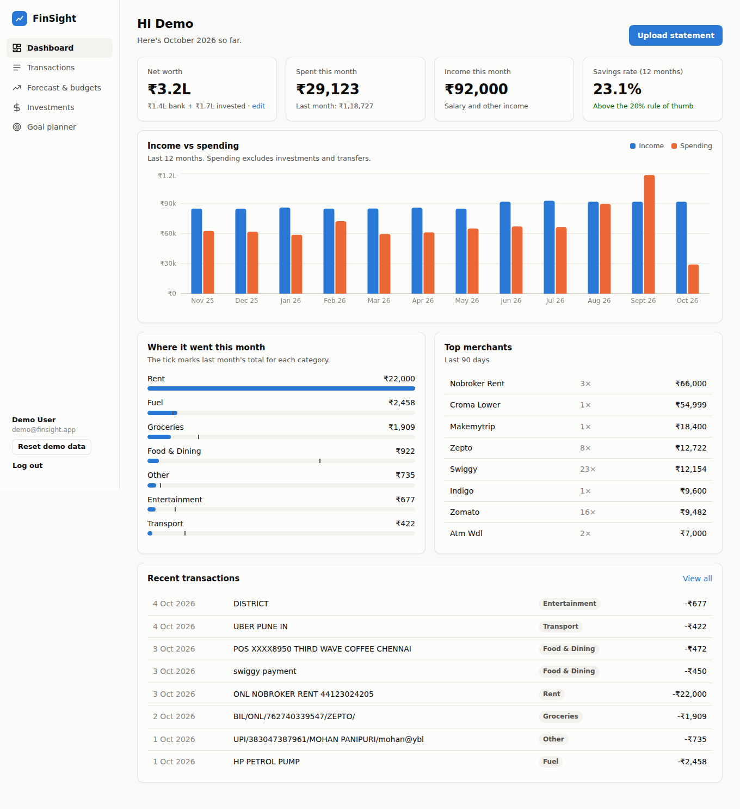
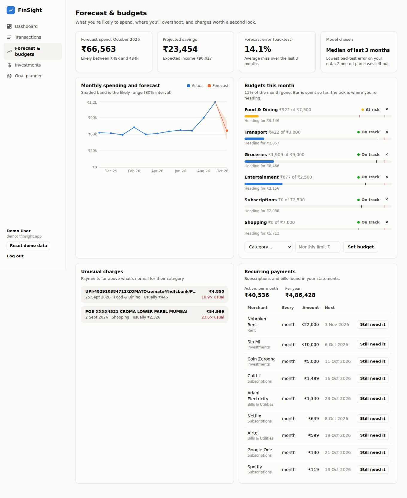
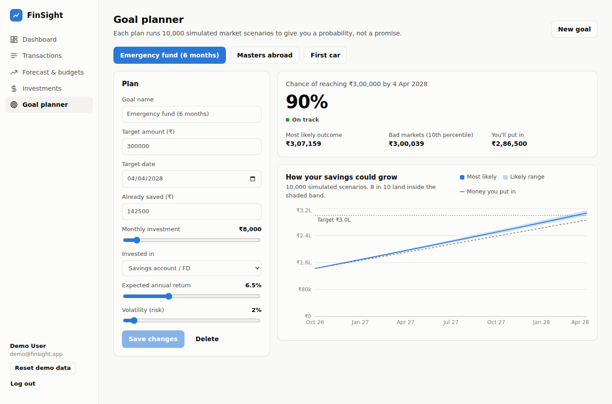
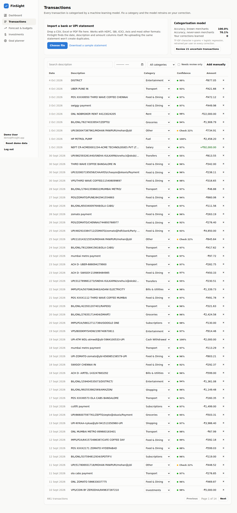
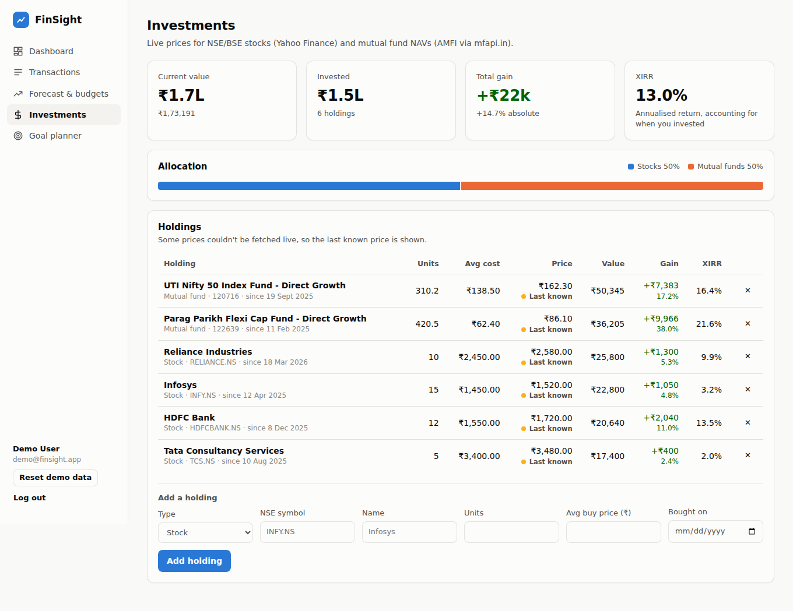
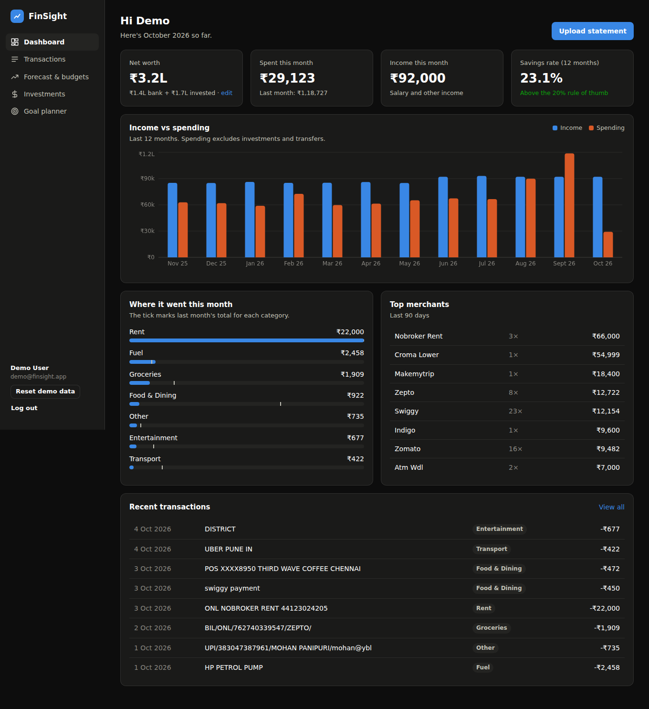
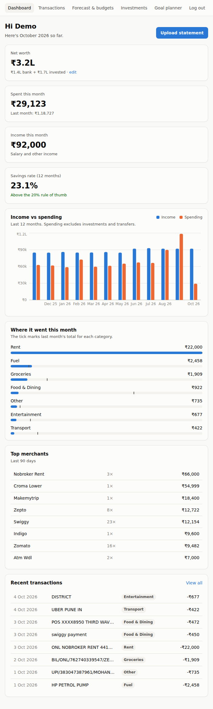

# FinSight

**A full-stack personal finance platform that turns raw Indian bank statements into categorised spending, forecasts, budget alerts and goal probabilities.**

Upload a statement from any bank (CSV, Excel or PDF). FinSight parses it, categorises every transaction with a machine-learning model that learns from your corrections, forecasts next month's spending, flags unusual charges and forgotten subscriptions, tracks your stocks and mutual funds at live prices, and runs 10,000-scenario Monte Carlo simulations to tell you how likely you are to hit a savings goal.



**Stack:** React 18 · Vite · Recharts · FastAPI · SQLAlchemy 2 · PostgreSQL / SQLite · scikit-learn · statsmodels · NumPy · pandas · JWT auth · Docker · GitHub Actions

---

## Features

### 1. Statement import with no manual entry
- Upload CSV, Excel or PDF statements; drag and drop supported.
- **Works across banks without one parser per bank.** HDFC writes "Narration / Withdrawal Amt.", SBI writes "Description / Debit", ICICI writes "Transaction Remarks". The parser scans for the header row below any bank preamble and maps columns by keyword. It handles separate debit/credit columns, signed amounts, `Dr/Cr` type columns, `(1,250.00)` negatives, and day-first dates.
- PDF tables are extracted with `pdfplumber`, with a line-by-line regex fallback for UPI-app statements that have no table lines.
- **Idempotent imports:** each row gets a SHA-256 fingerprint, so re-uploading an overlapping statement never duplicates data. Two genuinely identical rows (two ₹20 chais on the same day) are both kept.

### 2. ML transaction categorisation that learns from you
- **TF-IDF features** (character 2–5-grams plus word 1–2-grams) feed a **logistic regression** classifier across 19 categories. Character n-grams cope with narrations like `UPI/4829.../SWIGY/x@ybl` and truncated merchant names.
- Narrations are cleaned first: UPI handles (`zomato@hdfcbank`), masked card numbers, reference numbers and bank prefixes are stripped so the model sees the merchant.
- The direction of money is used as a prior: a credit is never classified as "Food & Dining".
- **Per-user retraining:** correcting a category saves a training label weighted 8×, retrains that user's model, applies the fix to every transaction from the same merchant, and re-categorises everything else the model owns.
- Low-confidence predictions (< 50%) land in a "Needs review" queue.

| Evaluation (held-out test set) | Accuracy | Macro F1 |
|---|---|---|
| Known merchants, new narration formats | **97.9%** | 0.98 |
| Never-seen merchants (grouped split by merchant) | **68.2%** | 0.72 |

The second row is the honest number. Test merchants never appear in training, and brand names like "ZEPTO" carry no meaning on their own, which is exactly why the correction loop exists. Run `python -c "from app.services.categorizer import evaluate_holdout; print(evaluate_holdout())"` to reproduce these numbers.

### 3. Cash-flow forecasting with model selection
- Three candidate models: **Holt's damped-trend exponential smoothing** (statsmodels), a weighted moving average and a 3-month median.
- **Rolling-origin backtesting** picks whichever model had the lowest MAPE on *your* history. The error is shown next to the forecast, so you know how much to trust it.
- One-off purchases flagged as anomalies (a laptop, a holiday) are excluded, so they don't inflate the baseline.
- Each forecast comes with an 80% prediction interval, projected savings, and per-category budget projections that blend the month-to-date run rate with typical spend. Each budget is marked **On track / At risk / Over budget**.



### 4. Unusual-charge and subscription detection
- **Anomalies:** a robust modified z-score (median and MAD, Iglewicz & Hoaglin) per category, so one big purchase can't hide another by inflating the standard deviation. Fixed payments (rent, EMIs, bills) and recurring merchants are excluded.
- **Subscriptions:** groups payments by normalised merchant, then looks for regular intervals (weekly, monthly, quarterly or yearly; ≥70% of gaps within tolerance) and stable amounts. It reports monthly and annual cost, next due date, price changes, and whether the subscription is still active.

### 5. Live investments, net worth and XIRR
- Stocks are priced live from Yahoo Finance (`INFY.NS`) and mutual funds from AMFI NAVs via [mfapi.in](https://www.mfapi.in), including a fund-name search.
- **XIRR** is implemented from scratch (Newton's method with a bisection fallback), both per holding and for the whole portfolio.
- Prices are cached for 15 minutes, and the last known price is used when the network is unavailable.
- Net worth = bank balance + current portfolio value.

### 6. Monte Carlo goal planner
- Simulates **10,000 market paths** month by month using geometric Brownian motion (log-normal returns) with monthly contributions, vectorised in NumPy.
- Reports the probability of reaching the target, median and 10th-percentile outcomes, and a p10–p90 fan chart.
- **Solves for the monthly SIP needed for an 80% chance** by bisection over the simulation.
- Live what-if sliders for contribution, return and volatility, with presets for FD, debt, balanced and equity.



### 7. Production-ready
- JWT authentication, bcrypt password hashing, and strict per-user data isolation (tested).
- **Demo account** seeded with 12 months of realistic transactions. They are run through the real classifier, not pre-labelled.
- Single Docker image: FastAPI serves the built React app. `docker-compose.yml` runs it with PostgreSQL, and `render.yaml` gives one-click deploy.
- GitHub Actions CI runs the test suite and the frontend build on every push.
- Responsive layout with light and dark mode.

---

## Architecture

```
frontend/ (React + Vite)           backend/ (FastAPI)
  pages/Dashboard.jsx      ──┐       app/routers/       auth · transactions · insights · planning
  pages/Transactions.jsx     │ /api  app/services/
  pages/Insights.jsx         ├────▶    parser.py        statement parsing (CSV / Excel / PDF)
  pages/Investments.jsx      │         categorizer.py   TF-IDF + logistic regression, per-user retraining
  pages/Goals.jsx          ──┘         forecasting.py   Holt / WMA / median + backtest model selection
                                       anomalies.py     robust z-score, recurring-payment detection
                                       portfolio.py     live prices, XIRR
                                       montecarlo.py    GBM simulation, required-SIP solver
                                     app/models.py      SQLAlchemy: users, transactions, budgets, holdings, goals
                                     tests/             pytest: parser, analytics, API
```

## Run it locally

**Backend** (Python 3.11+):
```bash
cd backend
python -m venv .venv && source .venv/bin/activate   # Windows: .venv\Scripts\activate
pip install -r requirements-dev.txt
uvicorn app.main:app --reload
```
The API runs on http://localhost:8000, with interactive docs at http://localhost:8000/docs. A SQLite database and the demo account are created on first start.

**Frontend** (Node 18+), in a second terminal:
```bash
cd frontend
npm install
npm run dev
```
Open http://localhost:5173 and click **Try the demo account** (`demo@finsight.app` / `demo1234`). To try an import, upload [`sample_data/hdfc_style_statement.csv`](sample_data/hdfc_style_statement.csv) or one of your own statements.

**Tests:**
```bash
cd backend && pytest -q
```

**Docker with PostgreSQL:**
```bash
docker compose up --build    # then open http://localhost:8000
```

## Deploy

On [Render](https://render.com), choose **New → Blueprint** and select this repo. `render.yaml` creates the web service and a PostgreSQL database. Environment variables:

| Variable | Default | Purpose |
|---|---|---|
| `DATABASE_URL` | SQLite file | Any SQLAlchemy URL; `postgres://` is accepted |
| `SECRET_KEY` | dev value | JWT signing key; **set this in production** |
| `LIVE_PRICES` | `1` | `0` disables outbound price lookups |
| `SEED_DEMO` | `1` | Creates and refreshes the demo account |

## API

Every endpoint is documented at `/docs` (OpenAPI). The main ones are:

| Method | Path | |
|---|---|---|
| POST | `/api/auth/register`, `/api/auth/login` | JWT auth |
| POST | `/api/transactions/import` | Upload a statement |
| GET | `/api/transactions` | Filter by month, category, search or needs-review |
| PATCH | `/api/transactions/{id}/category` | Correct a category and retrain the model |
| GET | `/api/model/metrics` | Held-out accuracy and correction count |
| GET | `/api/insights/forecast` | Forecast, backtest error, budget status |
| GET | `/api/insights/anomalies`, `/api/insights/subscriptions` | Unusual charges, recurring payments |
| GET | `/api/investments` | Holdings at live prices, XIRR, allocation |
| POST | `/api/goals/simulate` | Monte Carlo for any inputs |

---

<details>
<summary>More screenshots</summary>





</details>
